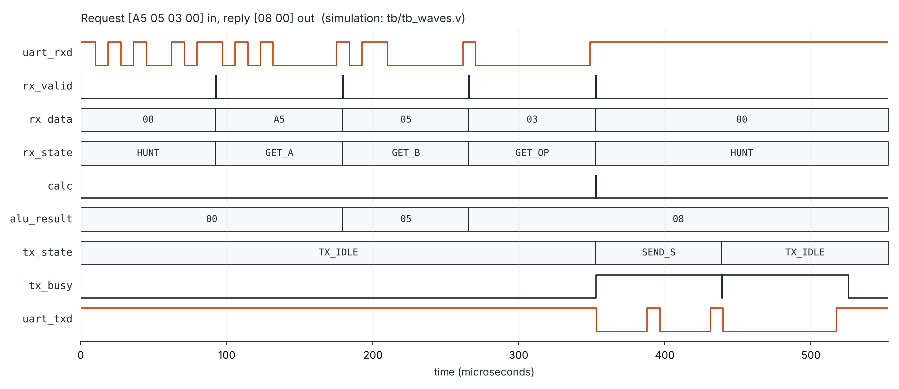
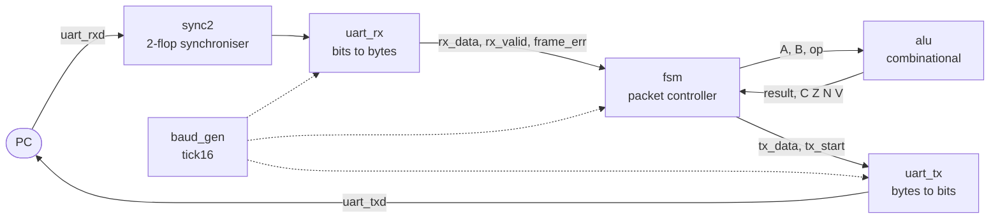

# 8-bit ALU over UART

I built an 8-bit ALU (Arithmetic Logic Unit) in Verilog and wrapped it in a UART (serial port) link, so a PC can send two numbers and an operation and get the answer back.

This repository contains the design, its verification, and the reasoning behind every design decision and every number.

## What it does, in one example

The PC sends 4 bytes. My design replies with 2 bytes.

```
PC sends :  A5  05  03  00        header, A = 5, B = 3, op = 0 (ADD)
FPGA says:  08  00                result = 8, status = 00 (no flags set)
```



*This picture is drawn from my own simulation (`tb/tb_waves.v`), not sketched by hand.*

## Block diagram



## Results at a glance

Every number here is explained in [Calculations](docs/05_calculations.md) and sourced in [Results](docs/06_results_and_limitations.md).

| Question | Answer | Where it comes from |
|---|---|---|
| Does the ALU work? | 1,048,576 input combinations checked, 0 mismatches | Simulation (Icarus Verilog) |
| Does the whole system work? | 2,024 of 2,024 reply bytes correct through the pins | Simulation |
| How fast is it? | 2,880 operations per second, limited by the serial link | Simulation + calculation |
| Baud rate error | +0.47% (115,741 actual vs 115,200 wanted) | Calculation, confirmed in simulation |
| Baud mismatch it survives | −5.25% to +4.55% | Simulation sweep, matches theory |
| Hardware used | 235 LUTs, 119 flip-flops | Vivado, after place and route |
| Maximum clock frequency | 151.4 MHz (target was 100 MHz) | Vivado timing report |
| Shared adder vs one adder per operation | 150 vs 171 LUTs (12.3% saved), about 4% slower | Vivado |

## What I did

| Stage | Status |
|---|---|
| Designed (specification and RTL) | Done |
| Simulated (Icarus Verilog 12) | Done, all five testbenches pass |
| Synthesised, placed and routed (Vivado 2024.1, Artix-7 XC7A100T) | Done |

## How to read this repository

| File | What is inside |
|---|---|
| [docs/01_architecture.md](docs/01_architecture.md) | The blocks, the packet format, and why I chose each one |
| [docs/02_alu_maths.md](docs/02_alu_maths.md) | Two's complement, carry vs overflow, shifts, with worked examples |
| [docs/03_rtl_walkthrough.md](docs/03_rtl_walkthrough.md) | The important parts of my Verilog, explained |
| [docs/04_verification.md](docs/04_verification.md) | My five testbenches and what each one proves |
| [docs/05_calculations.md](docs/05_calculations.md) | **Calculations and Mathematical Reasoning**, with the Formula Reference |
| [docs/06_results_and_limitations.md](docs/06_results_and_limitations.md) | All results with their sources, and the honest limitations |
| [docs/07_tradeoffs.md](docs/07_tradeoffs.md) | Every design trade-off I made |
| [docs/08_things_to_confirm.md](docs/08_things_to_confirm.md) | Things I still need to check |

## Folder layout

```
rtl/        the design: alu, fsm, baud_gen, sync2, uart_rx, uart_tx, alu_uart_top
tb/         testbenches
syn/        Vivado script, pin constraints, and the two files used only for the ALU comparison
scripts/    run all simulations, draw the waveform pictures
sim_logs/   the text output of each simulation run
docs/       the documentation
```

## Run the simulations

Needs Icarus Verilog (`iverilog`, `vvp`).

```
bash scripts/run_all_sims.sh        (Linux / macOS / Git Bash)
scripts\run_all_sims.bat            (Windows)
```

The full run takes about two minutes. The expected output is saved in `sim_logs/`.
