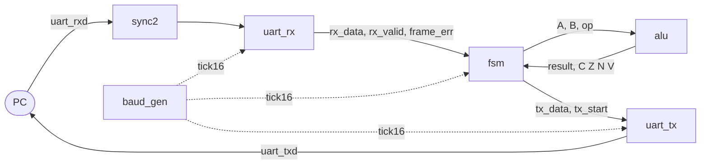
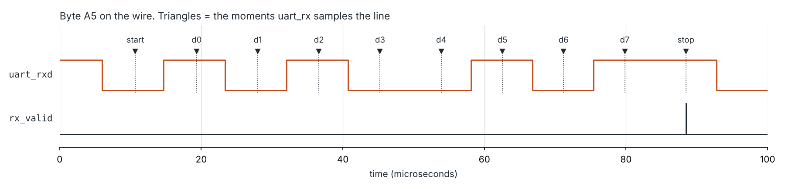
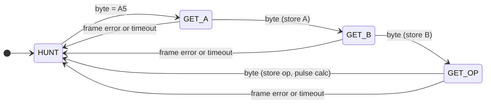
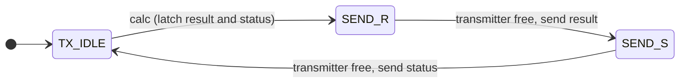

# 1. Architecture and Design Decisions

## 1.1 The idea

An ALU on its own has no way to talk to the outside world.
I added a UART (Universal Asynchronous Receiver Transmitter, a simple serial link) so that a PC can drive it.

The PC sends a **request** of 4 bytes. My design sends a **reply** of 2 bytes.

| Request byte | Meaning | Example |
|---|---|---|
| 1 | Header, always `A5` | `A5` |
| 2 | A | `05` |
| 3 | B (sent even for one-input operations, then ignored) | `03` |
| 4 | op (operation number, 0 to F) | `00` = ADD |

| Reply byte | Meaning | Example |
|---|---|---|
| 1 | result | `08` |
| 2 | status | `00` |

## 1.2 The blocks



| Block | File | Job | Has memory? |
|---|---|---|---|
| `sync2` | `rtl/sync2.v` | Makes the PC's signal safe to use with my clock | 2 flip-flops |
| `baud_gen` | `rtl/baud_gen.v` | Makes a one-clock pulse, `tick16`, 16 times per bit | Counter |
| `uart_rx` | `rtl/uart_rx.v` | Turns serial bits into a byte | State machine |
| `fsm` | `rtl/fsm.v` | Collects the 4 request bytes, sends the 2 reply bytes | Two state machines |
| `alu` | `rtl/alu.v` | Does the maths | **None.** Purely combinational |
| `uart_tx` | `rtl/uart_tx.v` | Turns a byte into serial bits | State machine |
| `alu_uart_top` | `rtl/alu_uart_top.v` | Wires everything together | Reset synchroniser |

## 1.3 The UART settings

| Setting | Value | Type |
|---|---|---|
| Clock | 100 MHz | Fixed by the board I targeted (Nexys 4) |
| Baud rate | 115,200 bits per second | My design choice (a parameter, can be changed) |
| Frame | 8N1: 1 start bit, 8 data bits, no parity, 1 stop bit | My design choice, the most common setting |
| Bit order | Least significant bit first | UART standard |
| Oversampling | 16 ticks per bit | My design choice, the usual value for UARTs |

One byte on the wire, for the value `A5` = `1010_0101`:

```
idle | start | d0 d1 d2 d3 d4 d5 d6 d7 | stop | idle
  1  |   0   |  1  0  1  0  0  1  0  1 |  1   |  1
```

The picture below is from my simulation. The triangles mark the exact moments my receiver reads the line. Each one lands near the middle of a bit.



## 1.4 The ALU operations

The operation is chosen by the lower 4 bits of the op byte. Four bits give 2^4 = 16 operations.

| op | Name | Result | C flag means | V flag |
|---|---|---|---|---|
| 0 | ADD | A + B | carry out | signed overflow |
| 1 | SUB | A − B | borrow | signed overflow |
| 2 | INC | A + 1 | A was FF | A was 7F |
| 3 | DEC | A − 1 | A was 00 | A was 80 |
| 4 | AND | A & B | 0 | 0 |
| 5 | OR | A \| B | 0 | 0 |
| 6 | XOR | A ^ B | 0 | 0 |
| 7 | NOT | ~A | 0 | 0 |
| 8 | SLL | shift A left by B | last bit pushed out | 0 |
| 9 | SRL | shift A right by B, fill with 0 | last bit pushed out | 0 |
| A | SRA | shift A right by B, fill with sign bit | last bit pushed out | 0 |
| B | ROL | rotate A left by B mod 8 | bit that wrapped around last | 0 |
| C | NEG | 0 − A | A was not 00 | A was 80 |
| D | SLT | 1 if A < B as signed numbers, else 0 | borrow of A − B | 0 |
| E | SLTU | 1 if A < B as unsigned numbers, else 0 | borrow of A − B | 0 |
| F | ROR | rotate A right by B mod 8 | bit that wrapped around last | 0 |

For every operation: Z = 1 when the result is 00, and N = bit 7 of the result.

## 1.5 The status byte

| Bit | 7 | 6 | 5 | 4 | 3 | 2 | 1 | 0 |
|---|---|---|---|---|---|---|---|---|
| Name | 0 | FRAME_ERR | reserved (0) | BAD_OP | V | N | Z | C |

- **BAD_OP**: the upper 4 bits of the op byte were not 0. The result is forced to 00 and the flags to 0.
- **FRAME_ERR**: a byte arrived with a bad stop bit at some point before this reply. It is "sticky": it stays set until it has been reported once, then it clears.

Example: `A5 7F 01 00` asks for 127 + 1. The reply is `80 0C`. Status `0C` = `0000_1100`, so V = 1 and N = 1.

## 1.6 The controller: two small state machines

The controller is split into a **parser** that listens and a **sender** that talks. They run side by side.





## 1.7 My design decisions

### Decision 1: one shared adder for seven operations

- **What I chose:** ADD, SUB, INC, DEC, NEG, SLT and SLTU all use the same adder. A small multiplexer in front picks what goes into it.
- **Why:** an adder is the most expensive part of this ALU. Seven separate adders would waste hardware.
- **How it works:** the adder always computes `x + y + cin`. Only the inputs change.

| Operation | x | y | cin | Why |
|---|---|---|---|---|
| ADD | A | B | 0 | A + B |
| SUB, SLT, SLTU | A | ~B | 1 | A − B = A + ~B + 1 |
| INC | A | 00 | 1 | A + 1 |
| DEC | A | FF | 0 | FF is −1 |
| NEG | 00 | ~A | 1 | 0 − A = ~A + 1 |

- **Alternative:** one adder per operation (the "flat" style). I wrote that too, in `syn/alu_flat.v`, only to measure the difference. The shared version uses 150 LUTs and the flat one 171, so I save 21 LUTs. The flat one is about 4% faster.

### Decision 2: a header byte, `A5`

- **What I chose:** every request starts with `A5`. The parser throws away bytes until it sees it.
- **Why:** without a header, one lost byte would shift every later packet by one position forever.
- **Why `A5`:** it is `1010_0101`, a pattern with many edges that is unlikely to appear from a stuck line (which gives `00` or `FF`).
- **Alternative:** a checksum byte. I did not add one. See the limitations.

### Decision 3: no FIFO

- **What I chose:** the parser takes each byte in the same clock it arrives. There is no buffer.
- **Why it is safe:** a request needs 4 frames to arrive, and a reply needs only 2 frames to leave. So the sender is always finished before the next request is complete. The numbers are in [Calculations, section 5.9](05_calculations.md).
- **Alternative:** my first version had a 4-entry FIFO because the controller stopped listening while it was replying. Splitting the controller into two machines removed the need.

### Decision 4: a timeout

- **What I chose:** if the PC stops in the middle of a packet for 480 ticks, the parser gives up and goes back to hunting for a header.
- **Why:** otherwise half a packet would wait forever and swallow the start of the next one.

### Decision 5: synchronous, active-low reset

- **What I chose:** every flip-flop resets on a clock edge when `rst_n` is 0.
- **Why:** the reset button is asynchronous, so I pass it through two flip-flops first. After that, a synchronous reset keeps everything in one clock domain and is simple to time.

### Decision 6: `tick16` is an enable, not a second clock

- **What I chose:** every flip-flop uses the same 100 MHz clock. The slow UART timing comes from a one-clock-wide enable pulse.
- **Why:** a divided clock would be a second clock domain, and I would have to worry about signals crossing between them.
