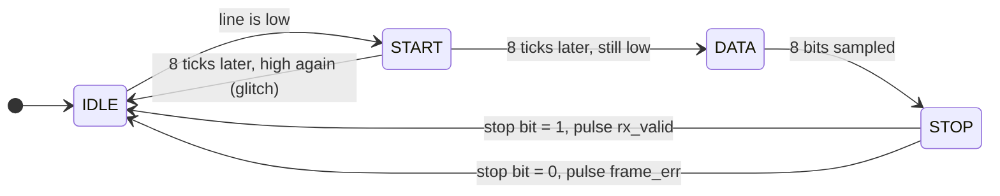

# 3. RTL Walkthrough

RTL (Register Transfer Level) is the Verilog that describes my hardware.
I only explain the parts that matter. The full files are in `rtl/`.

## 3.1 `baud_gen.v`: the tick generator

```verilog
localparam integer DIVISOR = (CLK_HZ + BAUD * 8) / (BAUD * 16);   // = 54
localparam integer W       = $clog2(DIVISOR);                     // = 6 bits

always @(posedge clk) begin
    if (!rst_n) begin
        cnt <= 0;  tick16 <= 1'b0;
    end else if (cnt == DIVISOR - 1) begin    // counted 0..53 = 54 clocks
        cnt <= 0;  tick16 <= 1'b1;            // pulse for exactly one clock
    end else begin
        cnt <= cnt + 1'b1;  tick16 <= 1'b0;
    end
end
```

**What it does:** counts 0, 1, 2 ... 53, then gives one pulse and starts again. So `tick16` is high for one clock out of every 54.

**Things to notice:**

- **The rounding trick.** Verilog integer division throws away the fraction. Adding half of the divider before dividing turns that into "round to nearest". The working is in [Calculations 5.2](05_calculations.md).
- **Off-by-one.** I compare against `DIVISOR - 1`, not `DIVISOR`. Counting 0 to 53 is 54 clocks. Comparing against 54 would give 55 clocks and a wrong baud rate. My loopback test measures this: the log says `tick16 period : 54 clocks`.
- **`$clog2(54)` is 6.** Six bits count up to 63, enough for 53.

## 3.2 `sync2.v`: the synchroniser

```verilog
always @(posedge clk) begin
    if (!rst_n) begin s1 <= 1'b1; s2 <= 1'b1; end   // reset to idle-high
    else        begin s1 <= d_async; s2 <= s1; end
end
```

**What it does:** passes the PC's signal through two flip-flops.

**Why:** the PC is not on my clock. Its edges can land exactly when my first flip-flop is sampling, and that flip-flop may hover between 0 and 1 for a while (metastability). The second flip-flop waits a full clock period, 10 ns, before anyone uses the value.

**Why it resets to 1:** a UART line idles high. Resetting to 0 would look like a start bit.

## 3.3 `uart_rx.v`: the receiver



The sampling schedule, counted in ticks from the tick where I first see the line low:

| Tick | What I sample |
|---|---|
| 8 | middle of the start bit |
| 24 | middle of d0 |
| 40 ... 136 | middle of d1 ... d7, every 16 ticks |
| 152 | middle of the stop bit |

152 ticks is 9.5 bits. That number sets how much baud mismatch I can survive.

The line that builds the byte:

```verilog
shreg <= {rxd, shreg[7:1]};   // LSB arrives first
```

**How it works:** each new bit enters at the left and everything moves one place right. After 8 bits, the first bit to arrive (d0) has travelled all the way to position 0, where the least significant bit belongs.

Example for `A5`. The bits arrive in the order 1, 0, 1, 0, 0, 1, 0, 1:

```
after d0: 1xxx_xxxx
after d1: 01xx_xxxx
after d2: 101x_xxxx
...
after d7: 1010_0101 = A5
```

**Things to notice:**

- The receiver goes back to IDLE at the **middle** of the stop bit, half a bit early. This means it is already looking for the next start edge when a back-to-back byte arrives.
- `rx_valid` and `frame_err` are set to 0 at the top of the block on every clock, and only set to 1 in one place. That is what makes them exactly one clock wide.

## 3.4 `uart_tx.v`: the transmitter

```verilog
shreg <= {1'b1, tx_data, 1'b0};   // {stop, d7..d0, start}
```

**What it does:** loads a 10-bit shift register with the whole frame, then sends bit 0 first.

For `tx_data = A5`: `shreg = 1_1010_0101_0`. Reading from the right: start = 0, then 1, 0, 1, 0, 0, 1, 0, 1, then stop = 1.

**Things to notice:**

- Each bit is held for 16 ticks, counted by `tick_cnt`.
- The start bit is put on the wire at the first tick **after** `tx_start`, so it is never cut short. The cost is that a reply waits for the next tick before it begins. That wait is almost all of my reply latency (see [Calculations 5.10](05_calculations.md)).

## 3.5 `alu.v`: the ALU

The ALU is two `case` statements with one adder in between.

**Step 1: choose the adder inputs**

```verilog
x = a;  y = b;  cin = 1'b0;  is_sub = 1'b0;      // defaults: ADD
case (op)
    4'h1, 4'hD, 4'hE: begin x = a;     y = ~b;    cin = 1'b1; is_sub = 1'b1; end // SUB, SLT, SLTU
    4'h2:             begin x = a;     y = 8'h00; cin = 1'b1; is_sub = 1'b0; end // INC
    4'h3:             begin x = a;     y = 8'hFF; cin = 1'b0; is_sub = 1'b1; end // DEC
    4'hC:             begin x = 8'h00; y = ~a;    cin = 1'b1; is_sub = 1'b1; end // NEG
    default:          begin end
endcase
```

The defaults at the top matter. In a combinational `always @(*)` block, every signal must get a value on every path. If I forgot one, the synthesiser would build a latch to remember the old value, which I do not want.

**Step 2: the one adder**

```verilog
wire [8:0] sum_full = x + y + cin;     // 9 bits so the carry-out is kept
wire       cout     = sum_full[8];
wire add_c = is_sub ? ~cout : cout;                       // subtract: no carry-out = borrow
wire add_v = (x[7] == y[7]) && (sum[7] != x[7]);          // same-sign inputs, different-sign answer
```

Making the sum 9 bits wide is how I get the carry-out. An 8-bit sum would silently drop it.

**Step 3: shifts with one extra bit**

```verilog
wire        [8:0] sll_t = {1'b0, a} << b;                 // bit 8 = last bit pushed out on the left
wire        [8:0] srl_t = {a, 1'b0} >> b;                 // bit 0 = last bit pushed out on the right
wire signed [8:0] sra_t = $signed({a, 1'b0}) >>> b;       // fills with the sign bit
```

`>>>` only fills with the sign bit when the value is declared `signed`. That is why the `$signed(...)` is there.

**Step 4: choose the result**

```verilog
result = 8'h00;  c = 1'b0;  v = 1'b0;      // defaults
case (op)
    4'h0, 4'h1, 4'h2, 4'h3, 4'hC: begin result = sum;  c = add_c;  v = add_v; end
    4'h4: result = a & b;
    ...
    4'hD: begin result = {7'b0, add_n ^ add_v};  c = add_c; end      // SLT
    4'hE: begin result = {7'b0, add_c};          c = add_c; end      // SLTU
endcase
```

## 3.6 `fsm.v`: the controller

**The parser takes a byte in the same clock it arrives:**

```verilog
GET_A:
    if (frame_err)     rx_state <= HUNT;
    else if (rx_valid) begin a <= rx_data; rx_state <= GET_B; end
    else if (timeout)  rx_state <= HUNT;
```

The order of the `if`s is a priority: a frame error beats a good byte, and a good byte beats the timeout.

**The sender latches the answer one clock after the last byte:**

```verilog
TX_IDLE:
    if (calc) begin
        if (bad_op) begin
            res_q  <= 8'h00;
            stat_q <= {1'b0, frame_sticky, 1'b0, 1'b1, 4'b0000};
        end else begin
            res_q  <= alu_result;
            stat_q <= {1'b0, frame_sticky, 1'b0, 1'b0, alu_v, alu_n, alu_z, alu_c};
        end
        frame_sticky <= 1'b0;
        tx_state <= SEND_R;
    end
```

The timing here is deliberate. On the clock where the op byte arrives, I store it and pulse `calc`. On the next clock, A, B and op are all stable in registers, the ALU has had one full clock period to settle, and I capture its output. This is the register-to-register path that Vivado times.

**"Set wins" for the sticky flag:**

```verilog
// ---- sticky error flag: written last, so "set" beats the sender's "clear" ----
if (frame_err) frame_sticky <= 1'b1;
```

In Verilog, when two non-blocking assignments to the same register happen in one clock, the **last one in the code** wins. The clear is higher up, the set is at the bottom. So if an error arrives in the exact clock I am reporting the previous one, the new error is not lost.

**The `!tx_start` guard:**

```verilog
SEND_R:
    if (!tx_busy && !tx_start) begin
        tx_data <= res_q;  tx_start <= 1'b1;  tx_state <= SEND_S;
    end
```

After I pulse `tx_start`, the transmitter needs one clock before `tx_busy` goes high. Without `!tx_start`, the next state would see "not busy" during that one clock and fire the second byte too early.

## 3.7 `alu_uart_top.v`: the top level

It only wires the blocks together, plus a 2-flop synchroniser for the reset button:

```verilog
reg rst_s1 = 1'b0, rst_s2 = 1'b0;
always @(posedge clk) begin
    rst_s1 <= cpu_resetn;
    rst_s2 <= rst_s1;
end
wire rst_n = rst_s2;
```

## 3.8 Things I noticed in my own RTL

None of these break my tests. They are known weaknesses or points worth stating clearly.

| # | Where | What I noticed | Possible improvement |
|---|---|---|---|
| 1 | `uart_rx.v` | Each bit is sampled only once, at its middle. A noise spike at that exact moment gives a wrong bit. | Sample 3 times around the middle (ticks 7, 8, 9) and take the majority. |
| 2 | `fsm.v` | In `TX_IDLE` I assume `calc` never arrives while the sender is busy. The timing argument says it cannot, but if it ever did, the request would be dropped with no flag. My testbench does not check for this directly. | Add a check in the testbench that `calc` is never high outside `TX_IDLE`. |
| 3 | `fsm.v` | After losing sync, the parser can lock onto a data byte that happens to be `A5`. | Add a checksum byte to the request. |
| 4 | `alu_uart_top.v` | The reset synchroniser starts at 0 using register initial values (`reg rst_s1 = 1'b0`). FPGAs support this. An ASIC flow would not. | None needed for an FPGA target. |
| 5 | `alu.v` | My specification talked about a 3-stage barrel shifter. In the RTL I used the `<<` and `>>` operators and let the tool build the shifter. I did not write the stages by hand. | None needed. The shifter structure is the tool's, not hand-built. |
| 6 | Comments | The header of `alu.v` still says "spec v1", and the header of `tb/alu_tb.v` calls the file `tb_alu.v`. | Tidy the comments. |
