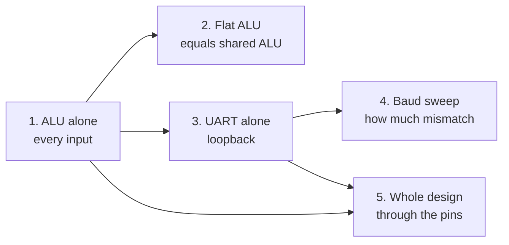
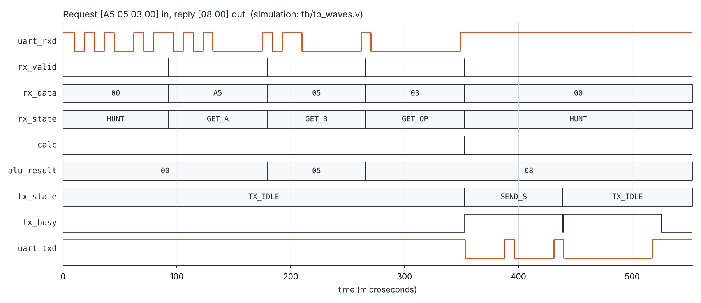
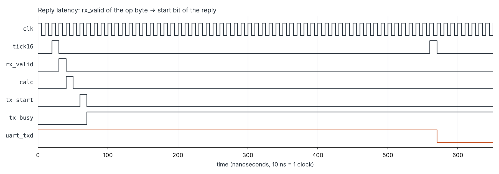

# 4. Verification and Simulation

All simulations use Icarus Verilog 12. The text output of every run is saved in `sim_logs/`.

## 4.1 My approach

I verified from the inside out. Each level is trusted before the next one uses it.



| # | Testbench | Question it answers | Result |
|---|---|---|---|
| 1 | `tb/alu_tb.v` | Is the ALU right for every possible input? | 1,048,576 checked, 0 mismatches |
| 2 | `tb/tb_alu_flat_equiv.v` | Does the flat ALU behave exactly like my shared-adder ALU? | 1,048,576 inputs, 0 differences |
| 3 | `tb/tb_uart_loopback.v` | Can my receiver read what my transmitter sends? | 256 of 256 bytes, 0 errors |
| 4 | `tb/tb_baud_sweep.v` | How wrong can the PC's baud rate be? | Pass from −5.25% to +4.55% |
| 5 | `tb/tb_top.v` | Does the whole system work through the pins? | 2,024 of 2,024 reply bytes correct |

## 4.2 Test 1: the ALU, exhaustively

**Why exhaustive is possible.** The ALU has 8 + 8 + 4 = 20 input bits and no memory. That is 2^20 = 1,048,576 combinations, small enough to try every one.

**How I know the right answer.** I wrote the ALU a second time inside the testbench, in a deliberately different style. This is the reference model.

| | My ALU (`rtl/alu.v`) | Reference model (in `tb/alu_tb.v`) |
|---|---|---|
| Subtraction | A + ~B + 1 on the shared adder | plain `a - b` on integers |
| Overflow | sign-bit rule | "is the true answer outside −128 to 127?" |
| Shifts | one `<<` with a wide value | a loop that shifts one bit at a time, B times |
| SLT | N xor V | signed integer compare |

If I had used the same trick in both, the same mistake would pass unnoticed. Writing it two different ways means a mismatch shows up if either one is wrong.

**The comparison.** For every input, all 12 output bits must match:

```verilog
if ({result, c, z, n, v} !== {exp_r, exp_c, exp_z, exp_n, exp_v}) begin
    errors = errors + 1;
```

I use `!==` instead of `!=` so that an unknown value (`x`) counts as a mismatch instead of slipping through.

**Output** (`sim_logs/1_alu_exhaustive.log`):

```
  op=1  A=05  B=03  ->  result=02   C=0 Z=0 N=0 V=0
  op=1  A=03  B=05  ->  result=fe   C=1 Z=0 N=1 V=0
  op=0  A=7f  B=01  ->  result=80   C=0 Z=0 N=1 V=1
  op=0  A=ff  B=01  ->  result=00   C=1 Z=1 N=0 V=0
  op=d  A=80  B=01  ->  result=01   C=0 Z=0 N=0 V=0
  op=e  A=80  B=01  ->  result=00   C=0 Z=1 N=0 V=0
  op=8  A=81  B=01  ->  result=02   C=1 Z=0 N=0 V=0
  op=a  A=80  B=09  ->  result=ff   C=1 Z=0 N=1 V=0
Checked 1048576 vectors, 0 mismatches  ->  PASS
```

These hand-picked lines are the same examples I worked by hand in [The Maths Behind My ALU](02_alu_maths.md).

## 4.3 Test 2: flat ALU equals shared ALU

For the hardware comparison I wrote a second ALU, `syn/alu_flat.v`, with one adder per operation. The comparison is only fair if both do exactly the same thing. This testbench drives both with all 2^20 inputs and compares their outputs.

```
alu vs alu_flat: 1048576 inputs, 0 differences -> PASS
```

## 4.4 Test 3: UART loopback

My transmitter is wired to my receiver through the synchroniser. I send all 256 byte values back-to-back.

The testbench also **measures** the timing, so my calculations are checked against the real RTL:

```
tick16 period      : 54 clocks  (DIVISOR)
one bit on wire    : 864 clocks = 8640 ns
one frame (10 bits): 8640 clocks = 86.40 us
bytes received     : 256 / 256
errors             : 0
```

| Measured | Calculated | Match |
|---|---|---|
| 54 clocks per tick | DIVISOR = 54 | Yes |
| 864 clocks per bit | 54 × 16 = 864 | Yes |
| 86.40 µs per frame | 10 × 8.64 µs | Yes |

A weakness of this test: both ends use the same baud generator, so it cannot find a wrong baud rate. Test 4 and test 5 cover that.

## 4.5 Test 4: baud sweep

A simulated PC sends 300 random bytes back-to-back at a rate that is deliberately wrong by a chosen percentage. Back-to-back is the hardest case because there is no idle gap to resynchronise on.

`m` is how much faster (positive) or slower (negative) the PC is, compared with my actual rate of 115,741 baud.

| Mismatch m | Bytes received | Wrong bytes | Frame errors | Result |
|---|---|---|---|---|
| −5.30% | 290 / 300 | 279 | 10 | FAIL |
| −5.25% | 300 / 300 | 0 | 0 | PASS |
| −5.00% | 300 / 300 | 0 | 0 | PASS |
| −4.00% | 300 / 300 | 0 | 0 | PASS |
| −2.00% | 300 / 300 | 0 | 0 | PASS |
| 0% | 300 / 300 | 0 | 0 | PASS |
| +2.00% | 300 / 300 | 0 | 0 | PASS |
| +4.00% | 300 / 300 | 0 | 0 | PASS |
| +4.55% | 300 / 300 | 0 | 0 | PASS |
| +4.60% | 18 / 300 | 17 | 281 | FAIL |

The edges match the theory in [Calculations 5.6](05_calculations.md): −5.26% and +4.58%.

## 4.6 Test 5: the whole design, through the pins

The testbench only touches the four pins: clock, reset, `uart_rxd` and `uart_txd`. A simulated PC sends bits at **exactly 115,200 baud**, while my design runs at 115,741. So the real 0.47% mismatch is part of every test.

For each packet, the testbench works out the reply it expects and puts it in a queue. A listener decodes every byte my design sends and puts it in a second queue. At the end the two queues must be identical, and there must be no extra bytes.

**Part 1: directed tests.** One per feature or fault.

| Test | PC sends | Expected reply | What it proves |
|---|---|---|---|
| T1 | `A5 05 03 00` | `08 00` | Plain ADD |
| T2 | `A5 7F 01 00` | `80 0C` | Signed overflow sets V and N |
| T3 | `33 77 A5 0A 03 01` | `07 00` | Junk before the header is thrown away |
| T4 | `A5 01 02 10` | `00 10` | Illegal op gives BAD_OP |
| T5a | `A5 06`, pause of 12 bit times, `07 00` | `0D 00` | A short pause is allowed |
| T5b | `A5 05`, 40 bit times of silence, `A5 01 02 00` | `03 00` only | Timeout drops the half packet |
| T6 | `A5 05 03*` (bad stop bit), then `A5 01 01 00` | `02 40` | Frame error drops the packet, next reply carries FRAME_ERR |
| T6b | `A5 01 01 00` | `02 00` | FRAME_ERR cleared after being reported once |
| T7 | `A5 05 03` `A5 01 01 00` (op byte lost) | `00 10` | A lost byte is flagged as BAD_OP, never silently wrong |
| T7b | `A5 02 02 00` | `04 00` | Recovery after the lost byte |
| T8 | `A5 10 20 00` `A5 30 40 01`, zero gap | `30 00` then `F0 05` | The second request arrives while the first reply is still being sent |

All of them print `OK` in `sim_logs/5_top_end_to_end.log`.

Checking T8 by hand: 30 − 40 in hex is 48 − 64 = −16 = `F0`. A borrow happened, so C = 1. Bit 7 is set, so N = 1. Status = `0000_0101` = `05`.

**Part 2: random packets.** 1,000 random requests with no gap between them. About 6% are given an illegal op on purpose (59 of them in this run).

```
Random phase: 1000 packets (59 BAD_OP), reply rate measured = 2880.0 ops/s
Reply bytes expected 2024, received 2024, mismatches 0, bad stop bits 0
RESULT: PASS
```

Where 2,024 comes from: 12 replies in Part 1 plus 1,000 in Part 2 is 1,012 replies, and each reply is 2 bytes.

## 4.7 Waveforms

These pictures are drawn by `scripts/plot_waves.py` from the dump of `tb/tb_waves.v`. That testbench sends the single request `A5 05 03 00`.

**The round trip.** Four bytes come in, the parser steps through its states, `calc` pulses, and two bytes go out.



What I check in this picture:

- `rx_valid` pulses four times, once per byte, and `rx_data` shows `A5`, `05`, `03`, `00`.
- `rx_state` goes HUNT, GET_A, GET_B, GET_OP, HUNT.
- `alu_result` becomes `08` as soon as B = 03 is stored. The ALU is combinational, so it always shows an answer for whatever is in the registers.
- `uart_txd` sends `08` then `00`.

**The reply latency.** A zoom on the moment the last request byte arrives.



`rx_valid`, then `calc` one clock later, then `tx_start`, then the transmitter waits for the next `tick16` before it pulls the line low.

## 4.8 Bugs and surprises

These are rebuilt from my code comments and project notes. I should add any others I remember (see [Things I Need to Confirm](08_things_to_confirm.md)).

| What happened | How I dealt with it |
|---|---|
| My first design needed a FIFO because the controller stopped listening while replying. | I split the controller into a parser and a sender. The FIFO, its test, and the OVERFLOW status bit were removed. Test T8 was rewritten to prove the new design handles overlapping traffic. |
| In the reference model, Z and N could be left over from the previous input. | They are now computed right after the expected result, every time (see the comment in `tb/alu_tb.v`). |
| In the loopback test, checking `tx_busy` straight after `tx_start` read the old value. | The testbench waits one extra clock so `tx_busy` has risen. The same one-clock gap is why `fsm.v` has the `!tx_start` guard. |
